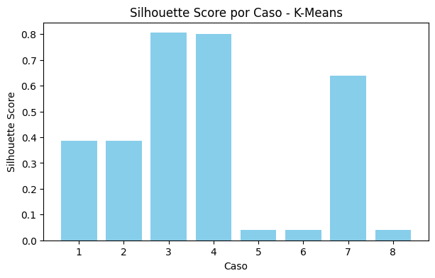
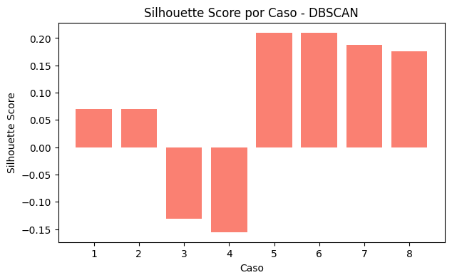

# ⚽ Predictor de resultados de partidos de fútbol

Análisis y modelos de machine learning para predecir resultados de partidos de la **Premier League (EPL)** y **La Liga** entre 2014 y 2024, usando aprendizaje supervisado y no supervisado.


## 📌 Resumen

El proyecto recorre un flujo completo de ciencia de datos: limpieza y preprocesamiento, manejo de valores atípicos, balanceo de clases, entrenamiento y comparación de modelos, y análisis de agrupamiento. Cada experimento se repite sobre **8 variantes del dataset** (con/sin normalización, con/sin outliers, balanceado/no balanceado) para medir cómo afecta cada decisión de preprocesamiento al desempeño.

## 🛠️ Tecnologías

Python · pandas · NumPy · scikit-learn · TensorFlow/Keras · imbalanced-learn · Matplotlib · Seaborn · Jupyter

## 🔍 Qué incluye

**Aprendizaje supervisado**
- Árbol de decisión (criterio Gini, visualización del árbol e importancia de variables)
- K-Nearest Neighbors (KNN)
- Support Vector Machine (kernel RBF)
- Red neuronal profunda (Keras, con BatchNormalization, Dropout y EarlyStopping)
- Métricas: precision, recall, F1-score, accuracy, curvas ROC y Precision-Recall multiclase

**Aprendizaje no supervisado**
- K-Means (selección de *k* con inercia y silhouette)
- DBSCAN (selección de ε con distancia a vecinos cercanos)
- Reducción de dimensionalidad con PCA para visualizar fronteras de decisión

## 📊 Algunos resultados

Con los datos completos de cada partido, la SVM y la red neuronal obtienen un F1-score ponderado de entre **0.41 y 0.46** en la clasificación de cuatro clases, una tarea difícil porque el fútbol tiene mucho componente aleatorio.

| Modelo | Mejor F1 ponderado | Dataset |
|---|---|---|
| Red neuronal | 0.463 | normalizado, con 5 % outliers, no balanceado |
| SVM (RBF) | 0.442 | normalizado, con 5 % outliers, no balanceado |

Agrupamiento (silhouette por caso):

| K-Means | DBSCAN |
|---|---|
|  |  |

## 🗂️ Estructura del repositorio

```
├── data/
│   └── matches_2014_2024.csv        # 8.360 partidos (EPL y La Liga)
├── notebooks/
│   └── 01_predictor_de_partidos.ipynb
├── images/
├── requirements.txt
└── README.md
```

## 🚀 Cómo ejecutarlo

```bash
git clone https://github.com/TU_USUARIO/predictor-partidos-futbol.git
cd predictor-partidos-futbol
python -m venv venv
source venv/bin/activate        # En Windows: venv\Scripts\activate
pip install -r requirements.txt
jupyter notebook notebooks/
```

Abre `01_predictor_de_partidos.ipynb` y ejecuta las celdas en orden. El notebook genera archivos CSV intermedios en la carpeta `notebooks/` (están ignorados por Git).

## 🧾 Datos

`data/matches_2014_2024.csv` contiene un partido por fila:

| Columna | Descripción |
|---|---|
| `id` | Identificador del partido |
| `season` | Temporada |
| `league` | Liga (`EPL` o `La_Liga`) |
| `datetime` | Fecha y hora |
| `home_team`, `away_team` | Equipo local y visitante |
| `goals_h`, `goals_a` | Goles del local y del visitante |
| `xG_h`, `xG_a` | Expected goals de cada equipo |
| `forecast_w`, `forecast_d`, `forecast_l` | Probabilidades pronosticadas de victoria local, empate y victoria visitante |
| `target` | Clase del resultado (0 a 3) |

## ⚠️ Limitaciones y próximos pasos

- Variables como `xG` se calculan una vez terminado el partido, así que el modelo no está pensado para predecir antes del pitazo inicial. Una versión futura usaría solo información previa (forma reciente, historial entre equipos).
- Las combinaciones de datasets del experimento pueden compartir filas entre entrenamiento y prueba; falta revisarlo antes de comparar modelos de forma definitiva.

## 👤 Autor

**Harrison Andrés Fernández Bolaño** — Ingeniero de Sistemas
📧 Hfernandez@unal.edu.co · 💼 [LinkedIn](https://www.linkedin.com/in/haanferbol/) · 🐙 [GitHub](https://github.com/Hfernandez05)

